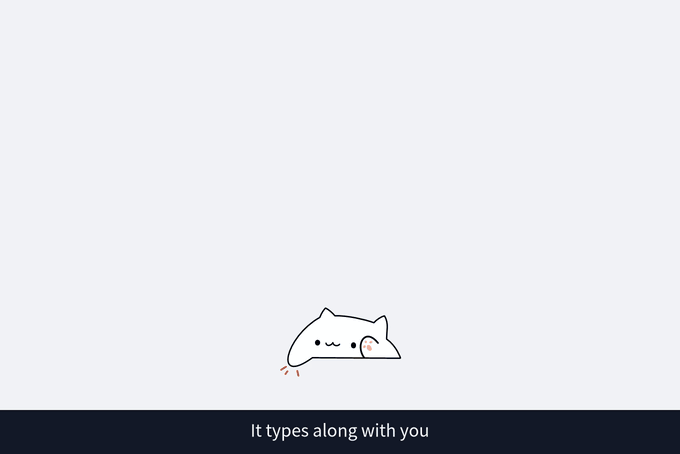

<div align="center">

# herdcat

**A desktop cat for Wayland that holds up a sign for every coding agent session.**

[](https://github.com/ZChenW/herdcat/releases)
[](LICENSE)

English · [简体中文](README.zh-CN.md)



</div>

herdcat sits at the bottom of your screen and types along with you. Every Claude Code, Codex, Grok, Kimi, Cursor, Copilot, Pi, opencode, Qwen Code and Antigravity session gets a sign that says what it is working on and whether it is busy, waiting for you or done. Click a sign to jump to its terminal.

## Install

```sh
# Arch Linux
git clone https://github.com/ZChenW/herdcat && cd herdcat/packaging/arch && makepkg -si

# From source: needs wayland, freetype2 and fontconfig
git clone https://github.com/ZChenW/herdcat && cd herdcat && make && sudo make install
```

On Nix, `nix run github:ZChenW/herdcat`. Other options are in [Install](docs/install.md).

## Get started

```sh
herdcat setup     # connect the agents you have installed
herdcat -w        # start the cat; config changes apply on save
```

To start it with your session, `systemctl --user enable --now herdcat`.

## Documentation

- [Install](docs/install.md): packages, the keyboard helper, starting at login
- [Configuration](docs/configuration.md): every option, with pictures
- [Signs](docs/signs.md) and [agents](docs/agents.md): what a sign shows, setup for each agent
- [Security](docs/security.md): what the keyboard helper can and cannot see
- [Troubleshooting](docs/troubleshooting.md)

## Credits

herdcat grew out of [wayland-bongocat](https://github.com/saatvik333/wayland-bongocat) by Saatvik Sharma. The Pi and opencode bridges are adapted from [OpenPets](https://github.com/OpenPetsHQ/openpets). Released under the [MIT License](LICENSE).
