# Configuration reference

This page lists every configuration option and command-line flag. The
annotated [herdcat.conf.example](../herdcat.conf.example) (installed as
`PREFIX/share/herdcat/herdcat.conf.example`) has every option with a comment;
`man herdcat` has the same reference.

## The config file

herdcat reads the first file it finds:

1. `$XDG_CONFIG_HOME/herdcat/herdcat.conf`
2. `~/.config/herdcat/herdcat.conf`
3. `./herdcat.conf`

`-c FILE` uses a different file. Run herdcat with `-w` (`--watch-config`) to
apply changes when you save the file, or run `herdcat --reload`.
`herdcat --check-config` validates the file without starting the overlay.

## Starter config

A short `~/.config/herdcat/herdcat.conf` to start from:

```ini
# Position & Size
cat_height=110
cat_align=center
# cat_x_offset=0
# cat_y_offset=0

# Appearance
overlay_height=120
overlay_opacity=0
overlay_position=bottom

# Input device (run herdcat-find-devices to find yours)
# keyboard_name=YOUR KEYBOARD NAME

# Session signs
# sign_style=fan          # fan, post or off
# sign_theme=light        # light, auto (follows the desktop) or dark
# sign_language=auto      # auto, en or zh

# Multi-monitor (comma-separated monitor names)
# monitor=eDP-1,HDMI-A-1

# Sleep mode (optional)
# idle_sleep_timeout=300
```

Style, language, font and theme can also be changed from the right-click card
(see [the switch card](signs.md#switch-card)); those choices are saved outside
the config file.

## Sign options

Every option below goes in the same file and is applied when you save it.

| Option | Default | What it does | Example |
| --- | --- | --- | --- |
| `sign_style` | `fan` | `fan`, `post` (signpost) or `off` | 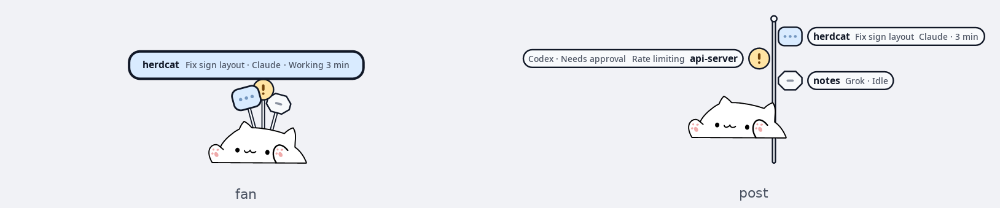 |
| `sign_max` | `10` | How many sessions get a sign, 1 to 10; the fan uses two rows above 5 | 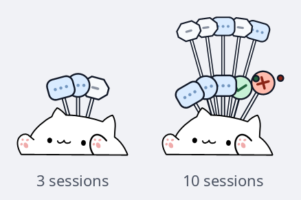 |
| `sign_idle` | `hover` | Show idle sessions on `hover`, `always` or `never` |  |
| `sign_theme` | `light` | `light`, `dark` or `auto` (follows the desktop) | 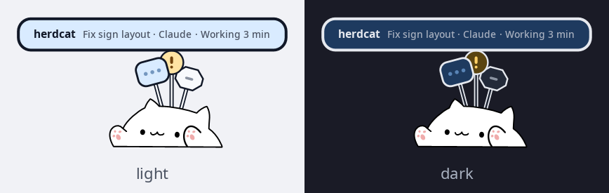 |
| `sign_language` | `auto` | `auto`, `en` or `zh` | 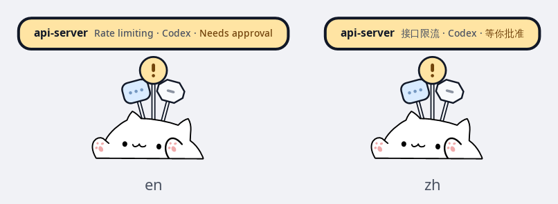 |
| `sign_font`<br>`sign_font_size` | system sans<br>`13` | Font family and size (10 to 20) | 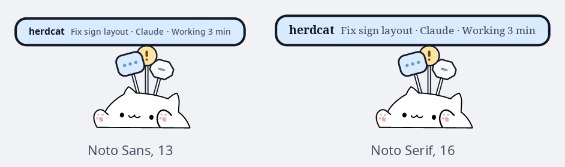 |
| `sign_animations` | `full` | `full`, `reduced` (transitions only) or `off` |  |
| `sign_done` | `sticky` | Finished sessions stay up until seen, or `timeout` | 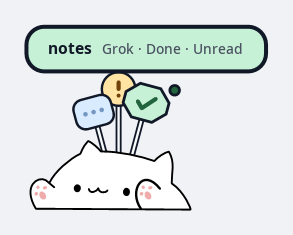 |
| `sign_typing_desk` | `1` | The sign of the terminal you type in comes down under the paws | 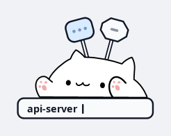 |
| `sign_desk_offset` | `0` | Move that desk away from the cat (up to 24) or closer (down to -6) | 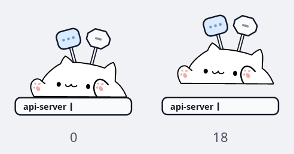 |
| `sign_name` | `project` | The bold name: `project` (directory) or `title` (session title) | 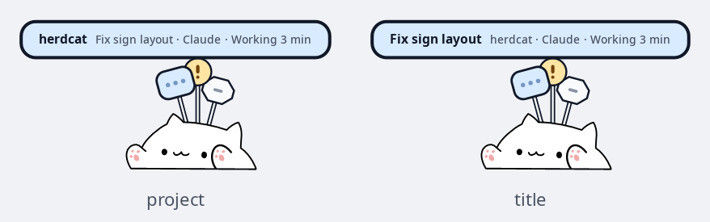 |
| `sign_name_extra` | `inline` | Where the other name goes: `inline`, `end`, `above`, `below` or `off` | 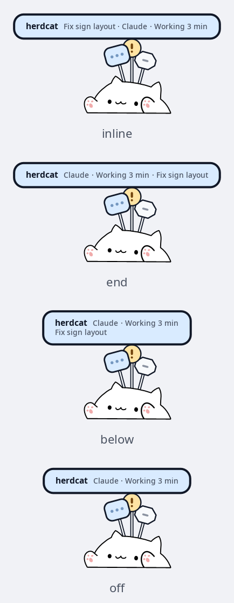 |
| `sign_title_length` | `16` | Longest title shown, 0 for all of it | 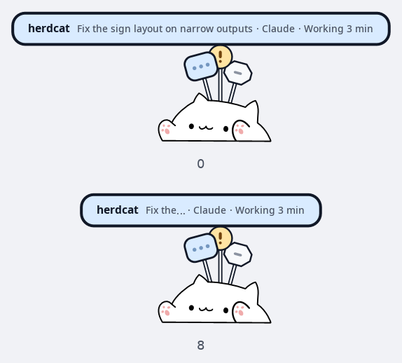 |
| `sign_nameplate` | unset | Your own nameplate, here `{agent} · **{title}**\n{project} · {state}` | 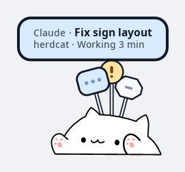 |

A nameplate template can use `{name}`, `{project}`, `{title}`, `{agent}` and
`{state}`, `**bold**`, and `\n` for a second line; see
[session names and titles](#session-names-and-titles). All sign options are
global: they cannot be set per monitor.

## All other options

| Option                     | Values            | Default  | Description                          |
| -------------------------- | ----------------- | -------- | ------------------------------------ |
| `cat_height`               | 10-200            | 40       | Cat size in pixels                   |
| `cat_align`                | left/center/right | center   | Horizontal alignment                 |
| `cat_x_offset`             | any int           | 100      | Horizontal offset from alignment     |
| `cat_draggable`            | 0/1               | 1        | Drag with the left mouse button      |
| `cat_y_offset`             | any int           | 10       | Vertical offset from center          |
| `enable_antialiasing`      | 0/1               | 1        | **Deprecated**, has no effect        |
| `overlay_height`           | 20-300            | 50       | Overlay bar height in pixels         |
| `overlay_opacity`          | 0-255             | 150      | Background opacity (0=transparent)   |
| `overlay_position`         | top/bottom        | top      | Screen edge position                 |
| `layer`                    | background/bottom/top/overlay | top | Wayland layer type            |
| `keyboard_device`          | /dev/input/path   | auto     | Specific evdev device to monitor     |
| `keyboard_name`            | string            | —        | Match device by name (for hotplug)   |
| `monitor`                  | comma list        | auto     | Monitors to render on                |
| `fps`                      | 1-120             | 60       | Animation frame rate                 |
| `mirror_x`                 | 0/1               | 0        | Flip cat horizontally                |
| `mirror_y`                 | 0/1               | 0        | Flip cat vertically                  |
| `enable_hand_mapping`      | 0/1               | 1        | Map keys to left/right hand frames   |
| `keypress_duration`        | ms                | 100      | How long key-down frame is held      |
| `idle_frame`               | 0-4               | 0        | Frame shown when idle                |
| `idle_sleep_timeout`       | seconds           | 0        | Sleep after idle (0=disabled)        |
| `agent_done_timeout`       | 0-3600 seconds    | 5        | Return done to idle (0=stay)         |
| `agent_interrupt_detect`   | 0/1               | 1        | Detect interrupted and failed turns  |
| `agent_cursor_wait_detect` | 0/1               | 1        | Detect Cursor approvals in tmux/kitty |
| `agent_stale_timeout`      | 0-86400 seconds   | 600      | Clear stale work (0=disabled)        |
| `hotplug_scan_interval`    | seconds           | 30       | Device rescan interval (0=once)      |
| `enable_scheduled_sleep`   | 0/1               | 0        | Enable time-based sleep schedule     |
| `sleep_begin`              | HH:MM             | 00:00    | Sleep schedule start time            |
| `sleep_end`                | HH:MM             | 00:00    | Sleep schedule end time              |
| `disable_fullscreen_hide`  | 0/1               | 0        | Keep overlay visible in fullscreen   |
| `compositor_experimental`  | 0/1               | 0        | Enable the experimental Hyprland focus support; Sway needs no opt-in |
| `enable_debug`             | 0/1               | 0        | Enable debug logging                 |
| `test_animation_duration`  | ms                | 200      | Test animation frame duration        |
| `test_animation_interval`  | seconds           | 0        | Test animation repeat interval       |

What the `agent_*` options do is described in [agents](agents.md):
`agent_done_timeout` and `agent_stale_timeout` under
[what a sign shows](agents.md#what-a-sign-shows), `agent_interrupt_detect` under
[interrupted and failed turns](agents.md#interrupted-and-failed-turns), and
`agent_cursor_wait_detect` under [Cursor Agent](agents.md#cursor-agent).
`compositor_experimental` is explained in [compositor support](compositors.md).

## Monitors

Monitor selection and appearance are updated on reload. Named outputs that are
disconnected wait for reconnection; automatic selection uses the first
available output. `--monitor NAME` overrides the config at startup.
`herdcat --list-monitors` prints the names.

Use `[monitor:NAME]` for per-monitor appearance and `[global]` to return to
global settings. Global settings apply before overrides regardless of section
order. Sections do not select monitors; list them in `monitor=`.

```ini
monitor=eDP-1,HDMI-A-1
cat_height=40
[monitor:HDMI-A-1]
cat_height=60
mirror_x=1
[global]
fps=60
```

These options can be overridden per monitor: `cat_height`, `overlay_height`,
`overlay_opacity`, `cat_x_offset`, `cat_y_offset`, `layer`, `overlay_position`,
`cat_align`, `mirror_x`, `mirror_y`, `cat_draggable`, `enable_antialiasing` and
`disable_fullscreen_hide`. Everything else, including input selection,
animation timing, sign options and the `agent_*` options, is global.

## Reloading

At startup, malformed entries produce warnings and are skipped. Reloads and
`--check-config` are strict: an invalid, missing or unreadable file leaves the
running configuration in place. Watching follows atomic replacements of the
file and reloads 300 ms after the last change.

## Keyboard selection

When neither `keyboard_device` nor `keyboard_name` is set, herdcat uses every
keyboard it can open. Explicit selectors never fall back to an unrelated
device. Stable `/dev/input/by-id/` and `/dev/input/by-path/` aliases work, and
the same device listed twice is used once. herdcat never changes device
permissions itself (see [installing](install.md#the-keyboard-helper)). Key
codes are never sent anywhere or logged, even with `enable_debug=1`.

## Command line

```bash
herdcat [OPTIONS]

  -c, --config FILE    Config file path (default: auto-detect)
  -m, --monitor NAME   Force specific monitor output
  -w, --watch-config   Auto-reload on config change
  -t, --toggle         Start/stop toggle
  --check-config      Validate config without Wayland or input access
  --list-devices      List devices, capabilities and access errors
  --list-monitors     List monitor names, dimensions and scales
  --doctor            Check config, protocols, outputs and input permissions
  --hide / --show     Change visibility of every overlay
  --pause / --resume  Show idle frame, discard input, or resume animation
  --state NAME        Set manual state: idle, working, waiting, done, error
  --sessions          List tracked agent sessions
  --pane PID ID       Report the focused kitty split
  --hook AGENT        Read a lifecycle event from stdin
  --reset-position    Restore configured positions on every output
  --reload / --status Reload config or query the running instance
  -h, --help           Help
  -v, --version        Version

herdcat setup [AGENT ...] [--status | --remove] [--dry-run] [--yes]
```

Controls talk to the running instance over a Unix socket that only your user
can use. Hide keeps the animation state; pause shows the configured idle frame
and ignores typing. Resume clears pending paw movement. Hidden and paused state
reset on restart, and controls never rewrite config files. Failed commands
exit nonzero. `herdcat setup` is described in [installing](install.md#connecting-your-agents)
and [agents](agents.md).

`--status` reports `agent=NAME` and `sessions=N`; `--sessions` lists each
session. Its `input=` field is `connected` once a keyboard is open, `denied`
when none is and some devices refused access (`denied=N` counts them, and a
second line says how to grant access), `searching` while no keyboard exists,
and `restarting` while the input helper restarts. See [agents](agents.md) for
session states and hook setup.

## Session sign limit

`sign_max` (1 to 10, default 10) limits how many sessions get a sign. With
more than five signs, the fan adds a second, slightly smaller row behind the
first. The five most urgent sessions stand in front, in this order: waiting,
error, unread completion, working, idle. Post signs keep alternating sides up
to ten rows. Hover names always appear above both rows.

## Typing desk distance

`sign_desk_offset` (-6 to 24, default 0) moves the typing desk, in logical
pixels at the default 110-pixel cat height and scaled with the cat. Positive
values move it farther from the cat (down for signs above the cat, up for
signs below), negative values closer. Screen edges can limit the movement.
`sign_typing_desk=0` turns the desk off.

## Session names and titles

| Option | Default | Values |
| --- | --- | --- |
| `sign_name` | `project` | `project`, `title` |
| `sign_name_extra` | `inline` | `off`, `inline`, `end`, `above`, `below` |
| `sign_title_length` | `16` | 0–64 characters; 0 disables truncation |
| `sign_nameplate` | unset | Fan template, at most 160 bytes |

`project` always shows the repository or directory name. `title` uses the
session title when there is one and falls back to the directory. By default
the sign shows the directory in bold followed by the title; a missing title,
or one equal to the directory name, is left out. Sessions in the same directory
keep the same name, without numbering.

On fan nameplates, `inline` puts the other name before the agent and state,
`end` after the state, and `above` and `below` add a second row (left out when
there is not enough room). Post boards show the other name after the bold name
for every setting except `off`, shortened with `…` to fit, and leave it out
when very little room remains. `off` hides it in both styles. The typing desk
shows only the main name. Titles longer than `sign_title_length` end with `…`.

For the directory with the title on its own row:

```ini
sign_name=project
sign_name_extra=below
sign_title_length=24
```

`sign_nameplate` replaces the fan nameplate entirely; post boards still follow
`sign_name` and `sign_name_extra`. Placeholders are `{name}` (the name chosen
by `sign_name`), `{project}`, `{title}`, `{agent}` and `{state}`. `**...**` is
bold; other text uses the lighter secondary style, and waiting and error states
keep their colour. A literal `\n` starts a second line (at most two lines).
A segment between ` · ` separators disappears when one of its placeholders is
empty, and so does an empty line. `{title}` is empty when it equals `{name}`.
When space runs out, secondary text is shortened before bold text. A template
with a mistake is rejected by `--check-config` and on reload, with the
position of the error; at startup herdcat warns and uses the built-in layout.

```ini
sign_name=project
sign_nameplate={agent} · **{name}**\n{state}
```

Session titles come from the agents' own session files for Claude, Codex,
Grok, Kimi Code, Pi and Copilot; opencode sends its session title through its
plugin. Until a session has a title, Claude, Codex, Grok, Kimi, Cursor and
Copilot use the first line of your first prompt as a temporary title (blank
prompts and slash commands are skipped). `--sessions` marks temporary titles
with `title~=`. Titles stay in memory and in a private runtime file under
`$XDG_RUNTIME_DIR/herdcat/`; they are never logged or sent anywhere.
