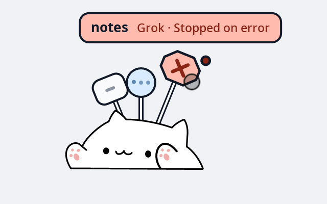
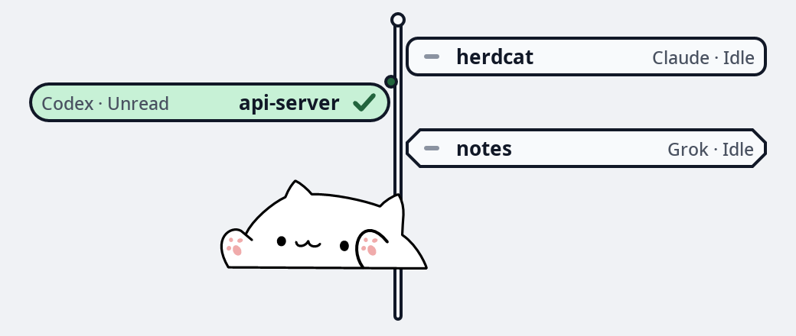

# Session signs

The cat holds up one sign for every agent session. This page explains what the
signs show, how to jump to a session's terminal, the right-click switch card,
and dragging the cat. Options are listed in [configuration](configuration.md#sign-options).

## Fan and post

Choose the style with `sign_style` or from the [switch card](#switch-card).

**Fan** (default) raises plates behind the cat. Hover a plate for its name;
plates waiting for approval rise higher, sway and show their names
automatically. With more than five signs the fan adds a second, smaller row
behind the first; the most urgent sessions stand in front.



**Post** stacks boards on a pole, alternating sides. Hover the cat to expand
every name at once; the names close shortly after the pointer leaves. Each row
pairs a state plate beside the pole with a name pill. Waiting and error rows
stay expanded.



These captures come from herdcat's own renderer with made-up sessions.

`sign_style=off` hides the signs and shows the agent state on the cat itself
instead.

## What a sign shows

The plate's shape tells the agent apart: Claude has a rounded rectangle, Codex
a circle, and other agents an octagon. Colour and icon show the state:
working, waiting for your approval, done, stopped on an error, or idle. Each
sign carries a bold name (the project directory by default) and the session
title; see [session names and titles](configuration.md#session-names-and-titles)
to change them.

Idle sessions appear only while the pointer is over the cat (`sign_idle`). At
most `sign_max` sessions, and never more than ten, get a sign; active and
recently updated sessions go first.

The fan names one sign at a time: the one under the pointer, otherwise the
session that has waited for approval longest. Answer it and the next one in
line is named.

A sign waiting for approval stays waiting until the approved tool finishes,
because agents report the request but not the answer. When you type in the
terminal of a waiting session, herdcat shows it as working straight away,
provided the window has had focus for a moment and the keys can only be meant
for that session. If no event from the
agent follows within 60 seconds, the sign goes back to waiting.

### Unread completions and errors

A finished session stays green with a dot until you have seen it: visit its
window, click the sign, send another prompt or end the session. Then it goes
away after `agent_done_timeout` seconds (default 5). A session that finishes
in the window you are looking at is already seen. With `sign_done=timeout`,
every completion goes away after that timeout, seen or not; switching to it
also starts the timeout for completions that are still unread.

A turn that stops on an error (quota used up, API failure) turns coral with a
cross and follows the same rule. In the fan style it is held higher than the
others and named on hover.

Noticing that you visited a window needs a [supported compositor](compositors.md).
Elsewhere, completions stay unread until you click the sign or send another
prompt. When kitty, tmux or WezTerm reports which split you are in, only the
session in that split counts as seen.

## Typing desk

When you type in an agent's terminal, its sign comes down under the paws as a
name board. It leaves after 2.5 seconds without typing, when the window loses
focus, when you submit, or when the cat is hidden. Clicks pass through the
board. herdcat uses only the fact that you are typing, never which keys.

The desk follows one session. In a kitty, tmux or WezTerm split that reports
its pane, that split's session is used; after you click a sign, that session
is used until focus leaves its window; otherwise the newest session in the
focused window. The desk needs a [supported compositor](compositors.md).
Set `sign_typing_desk=0` to turn it off, or `sign_desk_offset` to move it.

## Clicking a sign

Click a sign to jump to its session's terminal, including on another
workspace. Dragging a sign moves the whole cat. If the terminal window cannot
be found, the sign shakes briefly.

Jumping needs niri, Sway, or Hyprland with `compositor_experimental=1`; see
[compositor support](compositors.md). herdcat finds the terminal window by
walking up from the agent's process to the terminal that started it.

## Terminals

Some terminals can also focus the right split, tab or pane:

| Terminal | Window focus | Pane focus | Knows the current pane | Setup |
| --- | --- | --- | --- | --- |
| kitty | Yes | Yes | Through a watcher | `herdcat setup kitty` |
| tmux | Yes, through an attached client | Yes, across sessions and windows | Through tmux hooks | `herdcat setup tmux` |
| WezTerm | Yes | Yes, across tabs and windows | Asked when needed | None |
| Ghostty | Yes | No | No | None |
| Others | Yes | No | No | None |

```sh
herdcat setup tmux kitty --dry-run
herdcat setup tmux kitty --yes
herdcat setup tmux kitty --status
herdcat setup --remove tmux kitty --yes
```

Setup backs up the files it changes and can be removed again, like agent setup.

A terminal that runs several windows from one process may get the wrong window
when their titles do not tell them apart; herdcat then focuses the first one.

### kitty

`herdcat setup kitty` copies a small watcher script next to `kitty.conf` and
adds three marked lines: a restricted remote-control permission, the socket
settings and the watcher. Existing watchers are kept. Restart kitty
afterwards; reloading the config does not apply the socket, and only agents
started after the restart can be found by split.

To set it up by hand, add these lines to `kitty.conf`:

```
allow_remote_control password
remote_control_password "" focus-window
listen_on unix:${XDG_RUNTIME_DIR}/kitty-{kitty_pid}
```

`listen_on` is the socket herdcat talks to. The empty password with one listed
action lets a program on that socket move focus between kitty windows and
nothing else: it cannot type into a window, read one, or open and close them.
The broader `allow_remote_control socket-only` also works, but then any local
program that can open the socket can type into and read every kitty window.
Without the socket, a click still focuses the kitty window and leaves the
split alone.

Then copy [`integrations/kitty/herdcat_watcher.py`](../integrations/kitty/herdcat_watcher.py)
into the kitty config directory and add:

```
watcher herdcat_watcher.py
```

kitty allows several `watcher` lines, so keep any you already have. The
watcher tells herdcat which split has focus. It applies to windows opened
after kitty reloads its config, needs no extra remote-control permission, and
writes nothing to the terminal.

Reading the screen for [Cursor approvals](agents.md#cursor-agent) needs the
additional `get-text` permission, which herdcat never adds for you.

### tmux

`herdcat setup tmux` adds a marked block to `~/.tmux.conf` if it exists,
otherwise to `${XDG_CONFIG_HOME:-~/.config}/tmux/tmux.conf`, with three tmux
hooks that report pane changes. Run `tmux source-file` on your config or
restart tmux afterwards; after removal, restart tmux to clear the hooks. To
set it up by hand, source [`integrations/tmux/herdcat.conf`](../integrations/tmux/herdcat.conf).

A click focuses the window of the most recently active client attached to that
tmux session, then switches that client to the pane. Inside kitty it also
focuses the right kitty split. A session with no attached client cannot be
shown, so the sign shakes.

### WezTerm

WezTerm needs no setup, but `wezterm` must be in herdcat's `PATH`. herdcat
asks WezTerm for the current pane when a WezTerm window gains focus or when
you type; it does not poll. Switching panes without typing or changing window
focus is noticed at the next of those moments.

### Ghostty

Ghostty has no interface for selecting a tab or split, so herdcat focuses the
window only. It prefers the one window whose title contains the session title
or directory name. Several sessions in one Ghostty window share focus and are
marked seen together.

## Switch card

Right-click the cat or a sign. The signs step down and the cat holds up a card
with four rows. Each row shows its choices, and an ink thumb marks the current
one.

- **Style**: fan or post. The card closes and the signs come back up in the
  new style.
- **Language**: 中 or EN. Every label changes at once and the card stays.
- **Font**: the family name, drawn in that family, between two arrows. The
  arrows and the scroll wheel step through the families that cover the current
  language. The first entry is the system default.
- **Theme**: sun (light), automatic (follow the desktop) or moon (dark).
  Signs, nameplates, the card and the font panel change together.

A paw taps when a row changes. The card closes 800 ms after the pointer leaves
the cat and card, on a second right click, or after 6 seconds without use.
There is no card with `sign_style=off`.

### Font panel

Click the font name to open the font panel beside the card. It lists every
family, two per row, each drawn in its own face, with a count and an
All / Text / Mono filter. The four most recently chosen families come first.
More than ten rows scroll with the wheel.

While the panel is open, every session's sign comes up and takes the face
under the pointer, so you can judge a font on real signs. Click a cell to
choose and save it; the panel stays open for another try. Move the pointer
away, or right-click the cat, to close the panel and the card.

### Where choices are saved

Card choices are saved in `${XDG_STATE_HOME:-~/.local/state}/herdcat/prefs`,
and recent fonts in `fonts-recent` beside it. The config file is never
rewritten. A saved choice applies while the config value it replaced is
unchanged; editing that option in the config file afterwards makes the file
win.

## Themes

`sign_theme` is `light` (default), `dark` or `auto`. `auto` follows the
desktop's light or dark preference through the XDG desktop portal and needs
`busctl` (part of systemd). Without it, or without a portal, herdcat starts in
light; `herdcat --doctor` reports whether `busctl` is available. The cat
itself keeps its colours in both themes.

`sign_language=auto` picks simplified Chinese for a `zh` locale (from
`LC_MESSAGES`, then `LANG`) and English otherwise.

## Agents started by another agent

An agent started by another tracked agent, for example Claude running
`codex exec`, joins its parent's sign instead of getting its own. While the
child is working or waiting, the parent's agent label names it:

| Active children of Claude | Fan `{agent}` | Post |
| --- | --- | --- |
| One Codex | Claude + Codex | Claude +1 |
| Codex and Kimi | Claude + Codex + Kimi | Claude +2 |
| Two Codex | Claude + Codex ×2 | Claude +2 |
| Two Codex and one Kimi | Claude + Codex ×2 + Kimi | Claude +3 |
| Codex, Kimi and Pi | Claude + Codex + 2 | Claude +3 |

Fan signs also show a small count badge. While children are busy, an idle or
already-read parent looks like it is working and shows
`Waiting on subagent N min`. Waiting, error, unread and working parents keep
their own look. When the children finish, the label returns to the parent
alone. `--sessions` lists children with `parent=` and their real state.

If the parent session ends while a child is still working, the child gets its
own sign.

## Dragging the cat

Hold the left mouse button on the cat and move it. A click without moving
leaves it in place. Each monitor remembers its own position across restarts in
`${XDG_STATE_HOME:-~/.local/state}/herdcat/position`; positions are kept inside
the screen when the resolution changes. `herdcat --reset-position` returns
every cat to its configured position.

Only the cat itself catches clicks; the rest of the bar lets them through.
Hidden cats catch no clicks. Set `cat_draggable=0` (globally or per monitor)
to let every click through. A cat cannot be dragged to another monitor.

## Limits

- Text supports Latin and CJK scripts with font fallback, but not ligatures,
  right-to-left text or combining marks.
- herdcat tracks up to 32 sessions and shows at most ten signs.
- Clicking, the typing desk and noticing visited windows need a
  [supported compositor](compositors.md).
